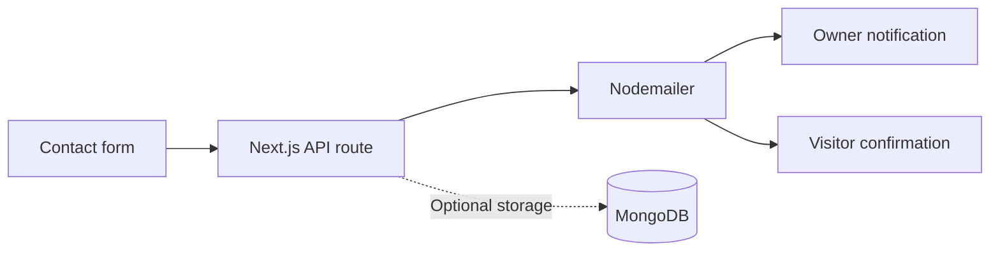

# Shashi Preetham Awari

### Full-Stack Development · AI & Machine Learning

A personal portfolio built with thoughtful interactions, animated visuals, and responsive layouts.

 

 

**Animated SVG hero** &nbsp; / &nbsp; **Interactive honeycomb** &nbsp; / &nbsp; **English + German**

---

## 🛠️ Tech Stack

| Layer | Technologies | Purpose |
| :--- | :--- | :--- |
| **Foundation** | Next.js 14 · React 18 · JavaScript | App Router pages, reusable components, state, and server routes |
| **Interface** | CSS · Bootstrap | Responsive grids, typography, spacing, and custom styling |
| **Motion** | SVG · Web Animations API · CSS animations | Name-outline drawing and flowing skills highlights |
| **Animation libraries** | GSAP · Framer Motion · Anime.js · Locomotive Scroll | Additional animation and scrolling dependencies |
| **Communication** | Nodemailer | Contact notifications and visitor confirmation emails |
| **Storage** | MongoDB | Optional contact-submission storage |
| **Quality** | ESLint · Next.js metadata | Code checks and page-level SEO configuration |

## ✨ How I Built It

I built the portfolio around **reusable React components**, with Next.js handling the pages and contact API. Custom CSS gives each section its own layout while keeping the dark visual style consistent.

### 01 / The first impression

A looping video sits behind an **animated SVG name**. Each letter is drawn using the Web Animations API, and the name stacks vertically on mobile to stay readable.

### 02 / Skills that respond

The **honeycomb layout** uses CSS and rounded SVG masks. Hovering or focusing a skill activates its whole category, with a light sweep moving through the matching cells in sequence.

### 03 / A place for the work

Project data supplies the **media previews, descriptions, and case studies**. The About page combines a profile illustration, a personal introduction, background highlights, and a compact tools grid.

### 04 / A working contact flow

The form uses React state for input, loading, and submission feedback. A Next.js API route handles email delivery, with optional database storage.

### 05 / The finishing details

| 🌐 Language | 📱 Responsive design | ⚡ First load |
| :--- | :--- | :--- |
| React Context switches between English and German using translation data and localized text. | CSS media queries adapt the navigation, hero, honeycomb, and forms to different screen sizes. | Local fonts and a startup loading screen help prevent unstyled content from appearing. |

---

**Designed & built by Shashi Preetham Awari**

From interface details to server-side functionality.

